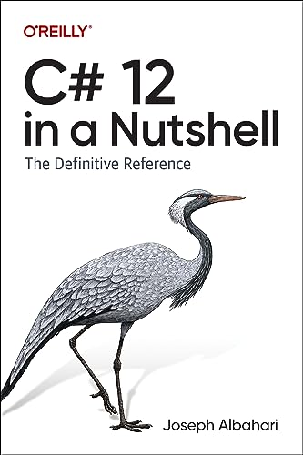

  

<h1 align="center">🚀 ترجمه جامع و آزاد کتاب C# 12 in a Nutshell</h1>

  <strong>کامل‌ترین مرجع عمیق، مفهومی و عملی زبان #C و اکوسیستم دات‌نت؛ ویژه برنامه‌نویسان فارسی‌زبان</strong>

  

  

  

  

---

## 💡 چرا این پروژه؟

کتاب **C# 12 in a Nutshell** نوشته‌ی *جوزف آلباهاری (Joseph Albahari)*، در سراسر جهان به‌عنوان **انجیل مهندسان سی‌شارپ** شناخته می‌شود. این اثر فراتر از آموزش‌های سطحی گام برمی‌دارد و معماری زیرین حافظه، همزمانی (Concurrency)، ساختار انواع و جزئیات دقیق کامپایلر را کالبدشکافی می‌کند.

هدف ما در این پروژه اوپن‌سورس:
* 🎯 **ترجمه‌ای روان، فنی و وفادار** بدون تحریف مفاهیم عمیق مهندسی
* 💻 **ارائه کامل و رایگان کدهای تست‌شده** برای تمام توسعه‌دهندگان
* 🌍 **غنی‌سازی منابع فارسی** برای ورود قدرتمند بچه‌های کامیونیتی به بازار کار جهانی

---

  ## ⚡ دسترسی سریع

| مرجع | توضیحات | لینک |
| :--- | :--- | :---: |
| 📖 **نسخه وب (گیتاب)** | تجربه خواندن تعاملی با پوسته تاریک/روشن و جستجوی سریع | [ورود به گیتاب ↗](https://hheydarian.github.io/Gitab/) |
| 📥 **سورس کدهای کتاب** | مخزن نمونه‌کدهای تست شده برای تک‌تک فصل‌ها | [مشاهده پوشه کدهای Book ↗](Book/) |

---

## 🔍 راهنمای خوانایی بهتر در گیت‌هاب

برای اینکه متون فارسی در گیت‌هاب و مرورگر با خط استاندارد و چشم‌نواز نمایش داده شوند:
1. افزونه رایگان **[فونت ایران (FontIran)](https://chromewebstore.google.com/detail/fontiran/edbchgkbejkdkdkpgenlaciegoidmjoh)** را روی مرورگر نصب کنید.
2. فونت پیش‌فرض را روی **وزیرمتن (Vazirmatn)** یا **ایران‌یکان** قرار دهید تا خوانایی کدها و متن به اوج برسد.

---

## 📚 فهرست سرفصل‌ها

تمامی **۲۶ سرفصل** کتاب به طور کامل ترجمه شده و آماده مطالعه است:

| شماره | نام سرفصل (انگلیسی) | عنوان فارسی | وضعیت | مطالعه مستقیم |
| :---: | :--- | :--- | :---: | :---: |
| **00** | Preface | پیش‌گفتار و مقدمه مؤلف | ✅ | [مطالعه فصل](Book/00/Preface.md) |
| **01** | Introducing C# and .NET | معرفی سی‌شارپ و اکوسیستم دات‌نت | ✅ | [مطالعه فصل](Book/01/Introducing-C%23-and-.NET.md) |
| **02** | C# Language Basics | مبانی و پایه‌های زبان سی‌شارپ | ✅ | [مطالعه فصل](Book/02/C%23-Language-Basics.md) |
| **03** | Creating Types in C# | ساخت انواع داده‌ای (Classes, Structs, ...) | ✅ | [مطالعه فصل](Book/03/Creating-Types-in-C%23.md) |
| **04** | Advanced C# | قابلیت‌های پیشرفته زبان سی‌شارپ | ✅ | [مطالعه فصل](Book/04/Advanced-C%23.md) |
| **05** | .NET Overview | نمای کلی و معماری دات‌نت | ✅ | [مطالعه فصل](Book/05/.NET-Overview.md) |
| **06** | .NET Fundamentals | مبانی و ارکان پایه فریم‌ورک دات‌نت | ✅ | [مطالعه فصل](Book/06/.NET-Fundamentals.md) |
| **07** | Collections | مجموعه‌ها و ساختارهای داده در دات‌نت | ✅ | [مطالعه فصل](Book/07/Collections.md) |
| **08** | LINQ Queries | پرس‌وجوهای جامع در LINQ | ✅ | [مطالعه فصل](Book/08/LINQ-Queries.md) |
| **09** | LINQ Operators | عملگرهای کاربردی و عمیق LINQ | ✅ | [مطالعه فصل](Book/09/LINQ-Operators.md) |
| **10** | LINQ to XML | پردازش داده‌های XML با LINQ | ✅ | [مطالعه فصل](Book/10/LINQ-to-XML.md) |
| **11** | Other XML and JSON | کار با فرمت‌های داده‌ای JSON و XML | ✅ | [مطالعه فصل](Book/11/Other-XML-and-JSON.md) |
| **12** | Disposal and Garbage Collection | مدیریت حافظه، رهاسازی منابع و GC | ✅ | [مطالعه فصل](Book/12/Disposal-and-Garbage-Collection.md) |
| **13** | Diagnostics | عیب‌یابی، سنجش کارایی و لاگینگ | ✅ | [مطالعه فصل](Book/13/Diagnostics.md) |
| **14** | Concurrency and Asynchrony | همزمانی و برنامه‌نویسی غیرهمگام (Async/Await) | ✅ | [مطالعه فصل](Book/14/Concurrency-and-Asynchrony.md) |
| **15** | Streams and IO | جریان‌های داده (Streams) و ورودی/خروجی فایل | ✅ | [مطالعه فصل](Book/15/Streams-and-IO.md) |
| **16** | Networking | برنامه‌نویسی شبکه و سوکت‌ها | ✅ | [مطالعه فصل](Book/16/Networking.md) |
| **17** | Assemblies | مدیریت اسمبلی‌ها و کامپایل | ✅ | [مطالعه فصل](Book/17/Assemblies.md) |
| **18** | Reflection and Metadata | بازتاب (Reflection) و کار با متادیتا | ✅ | [مطالعه فصل](Book/18/Reflection-and-Metadata.md) |
| **19** | Dynamic Programming | برنامه‌نویسی پویا و کلمه کلیدی dynamic | ✅ | [مطالعه فصل](Book/19/Dynamic-Programming.md) |
| **20** | Cryptography | رمزنگاری و استانداردهای امنیت داده | ✅ | [مطالعه فصل](Book/20/Cryptography.md) |
| **21** | Advanced Threading | رشته‌ها و مدیریت نخ‌های اجرایی پیشرفته | ✅ | [مطالعه فصل](Book/21/Advanced-Threading.md) |
| **22** | Parallel Programming | پردازش موازی و کتابخانه TPL | ✅ | [مطالعه فصل](Book/22/Parallel-Programming.md) |
| **23** | Span\<T\> and Memory\<T\> | بهینه‌سازی حداکثری حافظه با Span و Memory | ✅ | [مطالعه فصل](Book/23/SpanT-and-MemoryT.md) |
| **24** | Native and COM Interoperability | تعامل و ارتباط مستقیم با کدهای بومی و COM | ✅ | [مطالعه فصل](Book/24/Native-and-COM-Interoperability.md) |
| **25** | Regular Expressions | عبارات منظم (Regex) در ابعاد پیشرفته | ✅ | [مطالعه فصل](Book/25/Regular-Expressions.md) |

---

## 🤝 مشارکت در پروژه (Contributions Welcome)

این یک پروژه اجتماعی متعلق به تمام توسعه‌دهندگان است. هر تصحیح نگارشی، بهبود در واژه‌گزینی‌های تخصصی یا بهینه‌سازی فرمت کدها، ارزش این گنجینه را دوچندان می‌کند:

1. **فورک کنید (Fork):** ریپازیتوری را فورک کرده و یک برنچ جدید بسازید (`git checkout -b feature/edit-chapter-05`).
2. **اصلاح و بازبینی:** متن یا کدهای مورد نظر را اصلاح کنید (می‌توانید از دستورالعمل [assets/prompt.md](assets/prompt.md) برای ویرایش ادبی با AI کمک بگیرید).
3. **کامیت و ارسال:** تغییرات را ثبت کرده و یک Pull Request تمیز ارسال فرمایید.

> اگر سوال، ابهام یا پیشنهادی درباره ترجمه دارید، خوشحال می‌شویم آن را از طریق بخش **[Issues](https://github.com/hheydarian/csharp-12-in-a-nutshell-persian/issues)** مطرح کنید.

---

## ⚖️ مجوز و حقوق مالکیت معنوی

* **کتاب اصلی:** حقوق نشر و مادی/معنوی محتوای اصلی متعلق به آقای **Joseph Albahari** است.
* **متن ترجمه فارسی:** متن ترجمه شده تحت لایسنس بین‌المللی **[CC BY-NC-SA 4.0](https://creativecommons.org/licenses/by-nc-sa/4.0/)** (استفاده غیرتجاری با ذکر منبع و اشتراک‌گذاری با همان شرایط) منتشر می‌شود.
* **کدها:** تمامی نمونه‌کدهای پیاده‌سازی شده در این مخزن تحت مجوز **MIT License** آزاد و رایگان هستند.

---

  ⭐ <strong>اگر این ترجمه و ریپازیتوری به یادگیری شما کمک کرده، با دادن یک ستاره (Star) به دیده شدنش توسط دیگران کمک کنید!</strong> ⭐

  ساخته شده با ❤️ و عشق به توسعه‌دهندگان فارسی‌زبان

